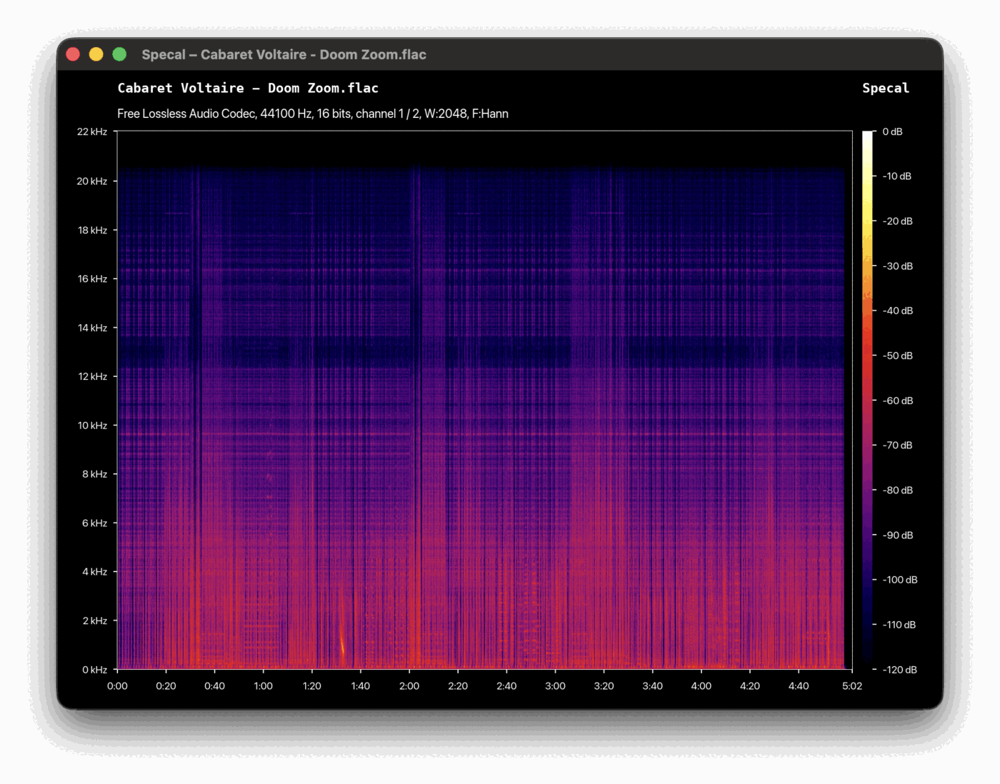

<div align="center">
<h1 align="center">
  
  <br>
  Specal
</h1>
<p>
A Rust re-implementation of <a href="https://github.com/alexkay/spek">Spek</a>, the acoustic spectrum analyser.
</p>
</div>

## Usage



### Keymaps

| Key       | Action                                                 |
| --------- | ------------------------------------------------------ |
| `c` / `C` | Cycle audio channel                                    |
| `f` / `F` | Cycle window function (Hann, Hamming, Blackman–Harris) |
| `w` / `W` | Increment/decrement FFT window size (256 to 16384)     |
| `p` / `P` | Cycle palette (Spectrum, SoX, Mono)                    |
| `l` / `L` | Increment/decrement lower dB limit (down to -140)      |
| `u` / `U` | Increment/decrement Upper dB limit (up to 0)           |
| `Esc`     | Reset the dB limits to -120 and 0                      |

## Development

### Crates

| Crate         | Path    | What it does                                                                                                                |
| ------------- | ------- | --------------------------------------------------------------------------------------------------------------------------- |
| `specal-core` | `core/` | Decoding (symphonia), FFT (realfft), palettes, axis ticks, page layout. No GUI code. Optional `svg` feature for SVG export. |
| `specal`      | `cli/`  | Command line: audio file in, SVG (with axes) or PNG (bare spectrogram) out.                                                 |
| `specal-gui`  | `gui/`  | iced window: drop an audio file on it.                                                                                      |

### Commands

```sh
cargo run --release -p specal -- track.flac -o track.svg        # Svg spectrogram with axes
cargo run --release -p specal -- track.flac -o track.png        # bare spectrogram
cargo run --release -p specal -- --help                         # palette, window, FFT size, dB range...

cargo run --release -p specal-gui                               # then drag a file onto the window
cargo run --release -p specal-gui -- track.flac                 # or open one directly
```

### Test

```sh
cargo test --workspace
```

## Credits

Specal is a Rust re-implementation of [Spek](https://github.com/alexkay/spek) by Alexander Kojevnikov and contributors. The analysis approach, page layout, axis tick selection, keyboard shortcuts and palettes are ported from Spek, and some source files are derived from it. Spek is licensed under the GPL-3.0-or-later, and Specal is released under the same licence.

The palettes also build on earlier work: the _Spectrum_ palette is a modified version of [Dan Bruton's algorithm](http://www.physics.sfasu.edu/astro/color/spectra.html), and the _SoX_ palette comes from [SoX](https://sox.sourceforge.net/) by Rob Sykes.

Audio decoding uses [Symphonia](https://github.com/pdeljanov/Symphonia), the FFT uses [RealFFT](https://github.com/HEnquist/realfft), and the GUI uses [iced](https://github.com/iced-rs/iced).

Specal is not affiliated with or endorsed by the Spek project.

## License

Copyright © 2026 Gethin Davies. Licensed under the [GNU General Public License v3.0 or later](LICENSE).
